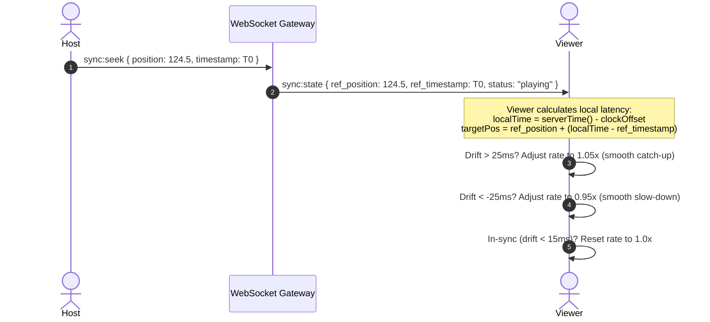

<div align="center">

# 🎬 StreamRoom

### Next-Generation Synchronized Streaming Platform & WebRTC Voice Mesh

[](https://fastapi.tiangolo.com)
[](https://react.dev)
[](https://www.typescriptlang.org)
[](https://vitejs.dev)
[](https://webrtc.org)
[](https://github.com/video-dev/hls.js)
[](LICENSE)

<p align="center">
  <b>StreamRoom</b> is an ultra-low latency, studio-grade watch party platform engineered for real-time video synchronization, multi-language audio track switching, decentralized WebRTC voice channels, and interactive co-browsing.
</p>

[Key Features](#-key-features) • [System Architecture](#-system-architecture) • [Audio Tracks Deep-Dive](#-why-mp4mkv-cannot-switch-audio-tracks-natively) • [Quick Start](#-quick-start) • [cPanel Deployment](#-cpanel--passenger-deployment)

---

</div>

## ✨ Key Features

- **⚡ Sub-25ms Synchronous Playback:** Proprietary NTP-style round-trip clock skew calculations dynamically measure network latency and apply imperceptible `±0.05x` playback rate micro-nudges to eliminate drift without audio stutter.
- **🎧 Studio MSE Audio & Subtitle Switcher:** Dynamic Media Source Extensions (MSE) pipeline powered by `Hls.js` and `Dash.js`. Seamlessly switch audio tracks (e.g. 5.1 Surround, Spanish, Director's Commentary) and subtitles via a Netflix-inspired player menu.
- **🎙️ Full-Duplex WebRTC Voice Mesh:** Peer-to-peer audio mesh with real-time Voice Activity Detection (VAD), animated speaking waves, hardware mic mute, and a dedicated **"Listen Only"** mode for mic-less participants.
- **💬 YouTube Live-Style Chat:** Frosted-glass chat stream with deterministic color-coded user avatars, `HOST` and `YOU` tags, and responsive layout that docks beneath video in mobile portrait view.
- **🎨 Netflix Obsidian & Apple TV Aesthetic:** Deep `#141414` dark obsidian canvas with crimson highlights, backdrop-blurred frosted glass (`rgba(16,16,16,0.72)`), and an interactive **mouse-repulsion text particle canvas** on the landing page.
- **🌐 Real-Time Co-Browsing:** Browse documentation, wikis, and web pages collaboratively with synchronized scroll offsets and multi-user cursor tracking.
- **📊 Real-Time Telemetry HUD:** Transparent diagnostics overlay tracking live download throughput (Mbps), buffer health, dropped video frames, signaling RTT, and clock drift.
- **🛡️ Granular Room Access Control:** Support for **Public** (open access), **PIN Protected** (hashed verification), and **Host Knock Approval** (interactive approval dialog visible over fullscreen video).

---

## 🏗️ System Architecture

```mermaid
flowchart TD
    subgraph Client [Browser Client (React 18 + TS)]
        UI[Netflix Obsidian UI & Canvas]
        SyncEngine[Clock Sync & Drift Engine]
        MSE[HLS.js / Dash.js Pipeline]
        VoicePeer[WebRTC Audio Mesh Peer]
    end

    subgraph Backend [FastAPI Backend Engine]
        Router[FastAPI REST API v1]
        WSGateway[WebSocket Room Gateway]
        RoomMgr[In-Memory Room State Manager]
        SQLite[(SQLite / MySQL Database)]
    end

    subgraph Peer2Peer [P2P WebRTC Audio Mesh]
        RemotePeerA[Peer A]
        RemotePeerB[Peer B]
    end

    UI --> SyncEngine
    SyncEngine <-->|WebSocket: sync:seek, sync:state, time:ping| WSGateway
    WSGateway <--> RoomMgr
    RoomMgr <--> SQLite
    Router <--> SQLite

    MSE -->|HTTP GET Chunk Streams| CDNHost[HLS / DASH CDN]
    VoicePeer <-->|WebRTC Signaling via WS| WSGateway
    VoicePeer <===>|SRTP Audio Mesh| RemotePeerA
    VoicePeer <===>|SRTP Audio Mesh| RemotePeerB
```

### Millisecond Synchronization Sequence



---

## 🧠 Why `.mp4` / `.mkv` Cannot Switch Audio Tracks Natively

One of the most frequent technical inquiries in web video development is:  
**"Why does my multi-audio MP4 or MKV file only play one audio language in the browser without track options?"**

### 1. Browser Native Demuxer Limitations
When a browser encounters a raw file via `<video src="movie.mp4">`, it delegates parsing to its internal C++ container demuxer:
- **Matroska (`.mkv`):** Major browsers (Google Chrome, Safari, Firefox, Edge) **do not support the `.mkv` container natively**. Browsers will either fail to decode the stream or throw an unsupported media format exception.
- **MP4 Container (`.mp4`):** While the W3C HTML5 specification proposed `HTMLMediaElement.audioTracks` (`AudioTrackList`), **Google Chrome, Chromium, and Mozilla Firefox have intentionally disabled multi-audio track selection by default** (`video.audioTracks` returns `undefined`). Chrome locks audio output to the first stream index in the MP4 file and discards secondary audio channels.

### 2. The Commercial Streaming Solution (HLS & MPEG-DASH)
Enterprise platforms like Netflix, Prime Video, and YouTube do not stream raw `.mp4` or `.mkv` files. Instead, they use manifest-based adaptive streaming:
- **HLS (`.m3u8`)** & **MPEG-DASH (`.mpd`)** separate the video from each individual audio track at packaging time.
- In StreamRoom, the player uses **Media Source Extensions (MSE)** via `Hls.js` and `Dash.js`. JavaScript inspects the master manifest, dynamically exposes available audio languages, and fetches and appends only the requested audio track segments directly into the browser's audio `SourceBuffer`.

---

## 💻 Tech Stack

| Domain | Technology | Description |
| :--- | :--- | :--- |
| **Frontend** | React 18, TypeScript, Vite | Component architecture & blazing fast HMR |
| **Styling** | Vanilla CSS Modules, Tokens | Netflix Obsidian dark tokens, Apple TV frosted glass |
| **Animation** | HTML5 Canvas 2D | Interactive text particle mouse-repulsion physics |
| **Video Engine** | HLS.js, Dash.js, HTML5 MSE | Adaptive bitrate & dynamic multi-audio track selection |
| **Voice Channel** | WebRTC PeerConnection Mesh | Full-duplex audio, Voice Activity Detection (VAD) |
| **Backend** | Python 3.10+, FastAPI, Uvicorn | High-throughput asynchronous ASGI signaling server |
| **WSGI Bridge** | a2wsgi, Phusion Passenger | cPanel / CloudLinux Apache deployment compatibility |
| **Database** | SQLAlchemy, SQLite / MySQL | Persistent rooms, access policies, session tokens |
| **Security** | Argon2id, Cryptographic Tokens | Robust PIN hashing and session state resumption |

---

## 🚀 Quick Start

### 1. Prerequisites
- **Node.js**: v18.0.0 or higher
- **Python**: v3.10 or higher
- **Package Managers**: `npm` and `pip`

### 2. Backend Setup
```bash
# Navigate to backend directory
cd backend

# Create virtual environment
python -m venv venv

# Activate virtual environment
# Windows:
.\venv\Scripts\activate
# Linux/macOS:
source venv/bin/activate

# Install dependencies
pip install -r requirements.txt

# Launch development server on http://localhost:8000
python run.py
```

### 3. Frontend Setup
```bash
# Open a new terminal and navigate to frontend directory
cd frontend

# Install dependencies
npm install

# Start Vite development server on http://localhost:5173
npm run dev
```

Visit **`http://localhost:5173/`** to experience the interactive landing page, create a streaming room, and invite friends!

---

## 🌐 cPanel / Passenger Deployment

StreamRoom is pre-configured for direct deployment on cPanel hosting using **Phusion Passenger** (via the *"Setup Python App"* interface):

1. **WSGI Entrypoint:** `backend/passenger_wsgi.py` adapts FastAPI's ASGI interface to Passenger's WSGI interface using `a2wsgi`.
2. **Apache Rules:** `backend/.htaccess` handles WebSocket connection upgrades (`ws://` and `wss://`) and passes authorization headers.
3. For step-by-step instructions, see the detailed [cPanel Deployment Guide](backend/CPANEL_DEPLOYMENT.md).

---

## 📁 Repository Structure

```text
StreamRoom/
├── Architecture.md             # System design and protocol specifications
├── APIContract.md              # REST & WebSocket payload schemas
├── backend/
│   ├── app/
│   │   ├── core/               # Configuration, security, fingerprinting
│   │   ├── db/                 # Database initialization & models
│   │   ├── routers/            # API v1, WebSocket gateway, CORS proxy
│   │   └── main.py             # FastAPI application entrypoint
│   ├── passenger_wsgi.py       # Phusion Passenger WSGI adapter
│   ├── .htaccess               # cPanel Apache & WebSocket proxy rules
│   ├── CPANEL_DEPLOYMENT.md    # Step-by-step cPanel setup guide
│   ├── requirements.txt        # Python production dependencies
│   └── run.py                  # Local Uvicorn runner
├── frontend/
│   ├── src/
│   │   ├── components/
│   │   │   ├── chat/           # YouTube Live-style synchronized chat
│   │   │   ├── diagnostics/    # Real-time telemetry HUD overlay
│   │   │   ├── landing/        # Landing page & mouse-repulsion particle canvas
│   │   │   ├── modals/         # Room entry, host settings, knock approvals
│   │   │   ├── notifications/  # Top join banner toast notifications
│   │   │   ├── player/         # UniversalMediaPlayer & Co-browser
│   │   │   └── voice/          # WebRTC voice mesh controller
│   │   ├── hooks/              # useClockSync, useVideoSync, useVoiceMesh
│   │   ├── services/           # WebSocket gateway & REST API client
│   │   └── styles/             # Netflix Obsidian tokens & glassmorphism
│   ├── package.json
│   └── vite.config.ts
└── README.md
```

---

## 📄 License

This project is licensed under the MIT License - see the [LICENSE](LICENSE) file for details.
